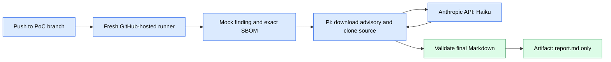

# Single-CVE agent investigation PoC

> Implementation status: Experimental, branch-only PoC. Not integrated with
> discovery, cleanup, review/apply, or VEX publication. Live inference has not
> been validated locally.

Pushes to `john15321/cve-ai-agnet-trooubleshooting-poc` run
`cve-investigation-poc.yml` without merging the workflow into the default branch.
The repository secret `CLAUDE_API_TEST` is required. Each push can spend API
credits; newer runs cancel older runs, but completed inference remains billable.

The workflow investigates only CVE-2026-41676 / GHSA-pqf5-4pqq-29f5 /
RUSTSEC-2026-0473 against the amd64 nightly
`4886.0.0+nightly-20261116-2100`.

`poc/cve-investigation.yaml` mocks a future discovery input: Flatcar version,
architecture, SBOM URL, package names/versions, CVE identifiers, and description.
The description comes from the primary RustSec advisory, also available through
the OSV API. No historical issue, recommendation, or resolution is supplied.

## Execution

Pi is explicitly instructed to download the primary RustSec page and OSV JSON,
then clone scripts at the matching tag with its Gentoo submodule. The source is
pinned to scripts commit
`d31f250d875be19992b5f1d26f0bccdc4f7042ea`, tag
`main-4886.0.0-nightly-20261116-2100`. Before accepting the report, the module
verifies the downloaded commit, literal nightly version, Gentoo packaging
directory, and saved advisory files without sourcing the shell manifest.
This maps the source to the requested version; it is not an
independently verified build attestation.

The runner prepares the exact versioned SPDX SBOM. Pi receives the standalone
finding, provenance, the full package inventory projected from the SBOM, and
the required download URLs and destination source path. Pi performs the source
and advisory retrieval with its read/bash tools, then inspects that evidence.
It is instructed to distinguish the Rust crate from the C library, inspect
vendoring/linking and configuration evidence,
and preserve uncertainty. No full Flatcar build environment is provisioned.

Pi 1.5.2 runs in JSON event mode using `claude-haiku-5-5`. The runner streams
assistant messages, tool commands, incremental tool output, and completion
status into the CI logs with a `[Pi]` prefix. Thinking blocks are not printed.
The model key is redacted from these messages, and Actions workflow-command
processing is suspended while untrusted agent output is logged.

Only the last completed assistant response becomes the Markdown report, after
the process settles successfully and passes completeness, size, and literal-key
checks. The report uses a compact issue-style field summary: source and CVE IDs,
Flatcar version and SBOM matches, assessment with scope/confidence, recommendation,
and a short summary. At most three evidence bullets and one uncertainty sentence
follow. Reports over 300 words fail validation instead of being silently truncated.
Investigation chronology, commands, and raw tool output stay in the CI logs.

These checks do not validate the truth of the assessment. Missing evidence,
failed inference, and malformed reports fail the job rather than fabricate a
successful report.

Download `cve-2026-41676-report` from the workflow run's Artifacts section.
Only `report.md` is uploaded, not source, evidence snapshots, sessions, or caches.
The report is an unreviewed maintainer aid, never an approved VEX statement.

## Limits and trust

This deliberately runs Pi directly on a fresh GitHub-hosted runner, not a
self-hosted/release/signing worker. It has a ten-minute inference process limit
and a twenty-minute job limit, not a hard token or dollar budget.

The workflow token has only `contents: read`, checkout credentials are not
persisted, and no GitHub token is passed to Pi. Only the inference step receives
the model secret. Pi receives a minimal environment, a fresh home directory, and
no auto-loaded extensions, MCP servers, skills, or context files.

**This is not a hardened sandbox.** Pi's shell tool runs as the runner user,
can access its own API key, and can access files outside the task directory.
Source/advisory instructions to avoid secrets, source edits, builds, and exploits
are prompt rules, not enforced restrictions. Run only trusted commits on this
branch, use a limited-credit key, and review the report as untrusted content.
An isolated credential-free build worker is a separate future step.

## Decision Log

| Decision | Reason |
|---|---|
| Branch push trigger, fixed single CVE and nightly | Run the experiment without merging or building a generic scanner |
| Anthropic via `CLAUDE_API_TEST`, pinned Pi | Reuse the working model connection while keeping the experiment separate |
| Pinned source and exact nightly SBOM, no `main`/`current` fallback | Avoid investigating different package evidence |
| Final response captured as one Markdown artifact | No issue mutations, publication credentials, or pipeline integration |
