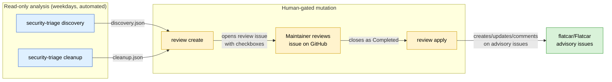
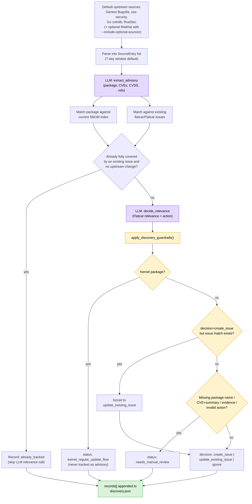
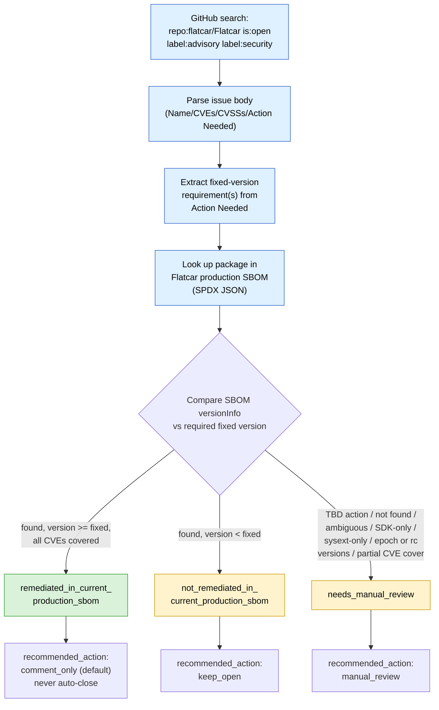
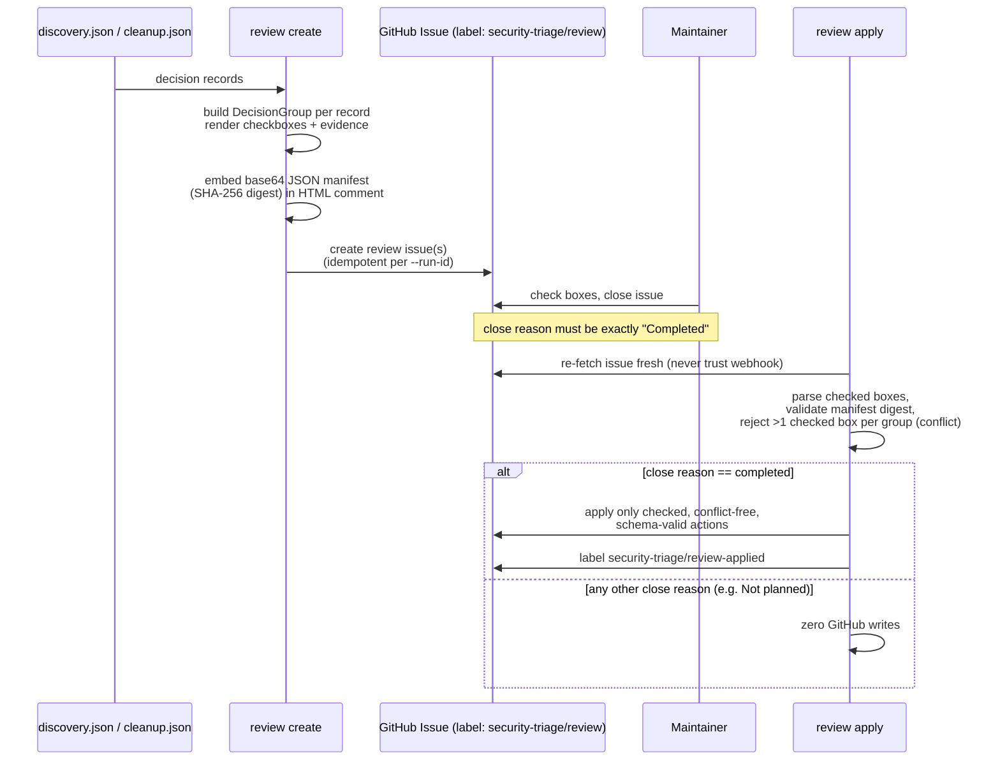
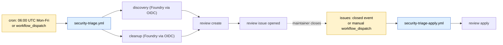
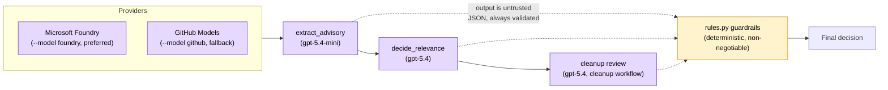

# Flatcar `security-triage`: How It Works

A Flatcar-specific advisory assistant with two read-only analysis workflows
(`discovery`, `cleanup`) plus one mutation-capable workflow (`review`) that is
always human-gated. It never writes to GitHub except through `review apply`,
and only after a maintainer explicitly closes a review issue as Completed.

## 1. Big Picture



Key rule: `discovery` and `cleanup` **never** accept a mutation flag. Only
`review apply` can touch GitHub issues, and only for actions a maintainer
explicitly checked.

## 2. Discovery: Finding New Vulnerabilities

Purpose: scan upstream sources, decide if a finding is Flatcar-relevant, and
propose either a new advisory issue or an update to an existing one.



**Guardrails matter more than the LLM.** `apply_discovery_guardrails()` in
`rules.py` overrides the model whenever:

- the package is a kernel package → forced to `kernel_regular_update_flow`
  (Kernel CVEs follow the regular stable kernel release flow, never an
  advisory issue)

- a `create_issue` decision collides with an existing issue match → forced to
  `update_existing_issue` (no duplicates)

- required evidence is missing (no package name, no CVE/summary, no SBOM or
  relevance evidence) → forced to `needs_manual_review`

## 3. Cleanup: Verifying Open Advisories Are Fixed

Purpose: for every open `advisory`+`security` issue in `flatcar/Flatcar`,
check whether the current production SBOM proves it's already fixed.

**Important: there is no multi-version/channel awareness.** Flatcar ships
four channels (Alpha, Beta, Stable, LTS) that genuinely run different
versions. This tool fetches exactly one hardcoded source, the **Alpha**
channel's `current` SBOM
(`https://alpha.release.flatcar-linux.net/.../flatcar_production_image_sbom.json`),
and nothing else. There's no `--channel`/`--stream` flag, and no logic that
cross-checks Beta/Stable/LTS. Since Alpha receives fixes first, a package can
show as "remediated" here while Stable/Beta/LTS users are still on the
vulnerable version for weeks. Earlier versions of this repo's README/CLI help
text incorrectly said "Stable production SBOM", which has been corrected to
"Alpha channel" to match actual behavior.



Conservative-by-default rules baked into the logic:

- `advisory/only-sdk` and `advisory/sysext` issues are **never** marked
  remediated from the production SBOM alone (SDK/sysext content isn't
  necessarily represented there) → always `needs_manual_review`.

- Multi-CVE issues need **every** CVE covered by the same fixed version, or
  they fall to `needs_manual_review`.

- Struck-through (`~text~`) CVE/action fragments in manually-edited issues are
  ignored before extraction.

## 4. Review: The Only Path to Mutating GitHub Issues



Safety properties:

- **Fresh re-fetch, not webhook trust**: `review apply` re-reads the issue
  and re-validates everything before mutating anything.

- **Fail closed on conflict**: more than one checked box in a decision group
  → skipped, reported, no action taken.

- **Additive-only body edits**: existing `Action Needed`, `Summary`, CVEs,
  and human text are preserved; guarded field helpers rebase changes onto the
  *current* body.

- **Idempotent**: comments carry a hidden action-ID marker so reruns never
  repost; once every group is terminal, the issue gets
  `security-triage/review-applied` and further closes are no-ops.

- **Granular flags**: `--enable-create-issues`, `--enable-update-issues`,
  `--enable-post-cleanup-comments`, `--enable-close-issues` gate mutation
  categories individually (`--enable-all-review-actions` is shorthand for all
  four). These flags exist only on `review apply`.

## 5. Automation in GitHub Actions



- `security-triage.yml`: holds `issues: write`, but the only step that uses
  it is `review create` (opening/reusing the review issue); discovery and
  cleanup themselves never call it. Uses GitHub OIDC (`azure/login`) to mint
  a short-lived Foundry bearer token; no client secret is stored.

- `security-triage-apply.yml`: triggers only on `issues: closed`; performs no
  model inference and no cloud calls; purely a deterministic GitHub API
  operation gated by the Python `review apply` logic.

- Both workflows currently pin `SECURITY_TRIAGE_ADVISORY_REPO` and
  `SECURITY_TRIAGE_REVIEW_REPO` to `flatcar/security-triage` itself for battle
  testing, before ever pointing at the real `flatcar/Flatcar` repo.

## 6. LLM Usage: Bounded, Advisory-Only



The LLM only extracts/summarizes/proposes; it never directly creates,
updates, or closes anything. All upstream text (Bugzilla comments, advisory
bodies) is treated as untrusted data, never as instructions: mentions are
neutralized and non-Gentoo `refmap.gentoo` URLs are rejected.

## 7. Quick Command Reference

```bash
# Analysis (read-only)
security-triage discovery --model foundry --output reports/discovery.json
security-triage cleanup   --model foundry --output reports/cleanup.json

# Human-gated mutation
security-triage review render --discovery-json ... --cleanup-json ... --output-dir reports/preview
security-triage review create --discovery-json ... --cleanup-json ... --run-id "$RUN_ID"
security-triage review apply  --issue-number 123 --enable-all-review-actions
```

## TL;DR

1. **Discovery/cleanup produce evidence, never touch GitHub.**
2. **Deterministic guardrails in `rules.py` override the LLM** for kernel
   packages, duplicates, missing evidence, and SDK/sysext ambiguity.
3. **`review create/apply` is the single, auditable gate** for every GitHub
   mutation, requiring an explicit maintainer "Completed" close and only
   acting on checked, conflict-free, freshly-revalidated actions.
