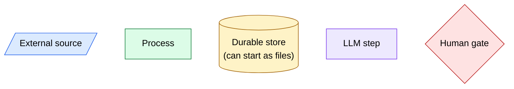
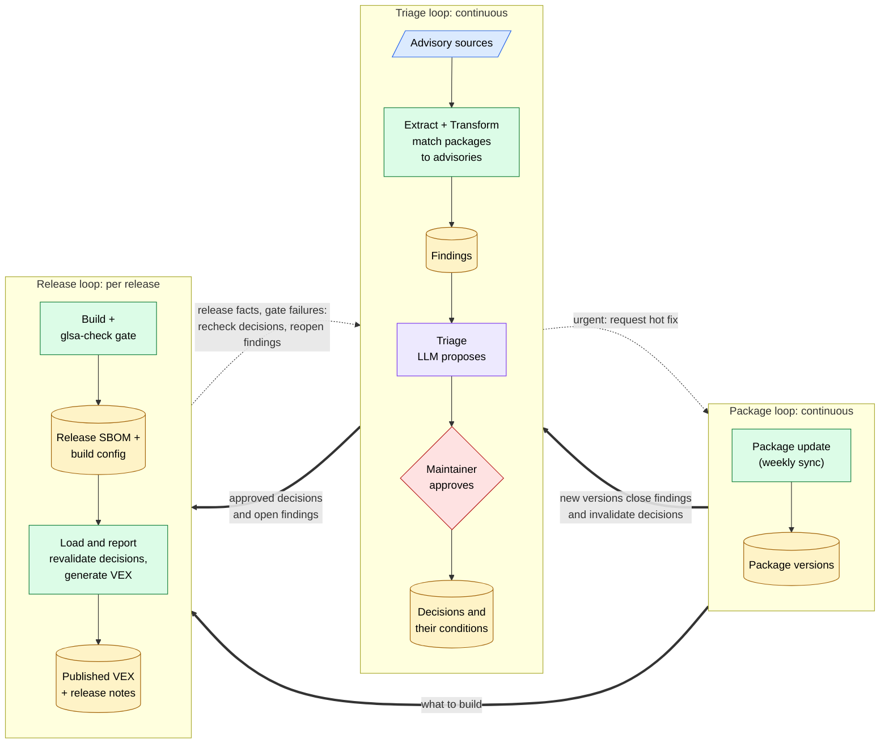
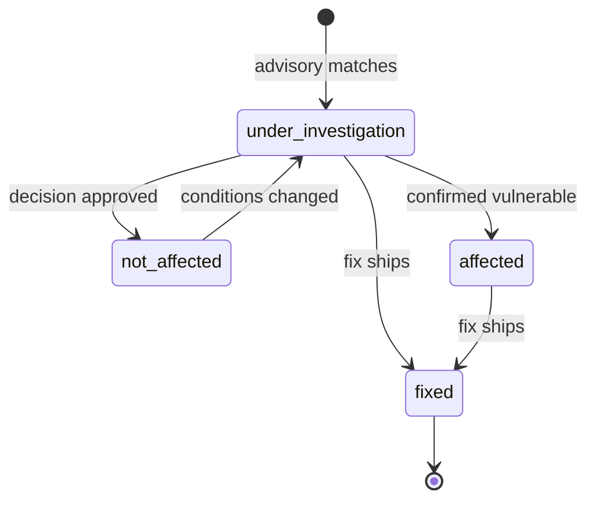
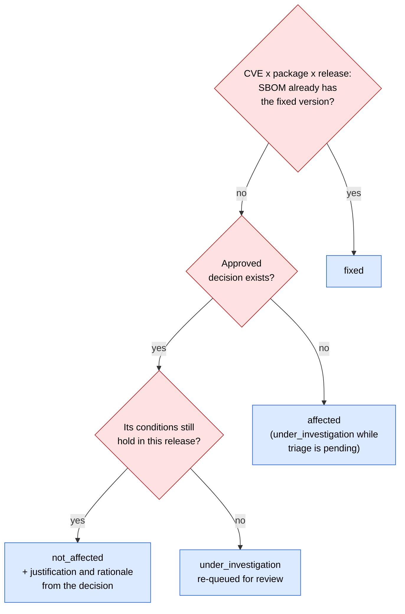
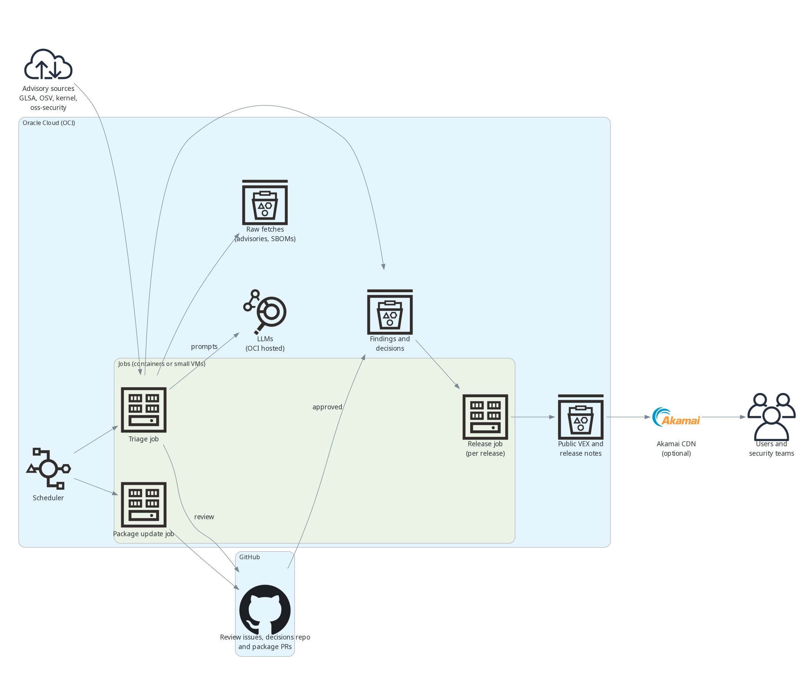

# Proposal (v1): ETL-Based Security Pipeline with LLM-Assisted CVE Triage

> **Status: v1, work in progress, not implemented.** A discussion document, not a finalized design. This is the first version of the proposal, written up after the first maintainer review; expect it to change as the open questions are resolved and the tools get built. Feedback is welcome.

## TL;DR

Scanners report CVEs against packages that are often not exploitable in a Flatcar image, for example because a USE flag disables the vulnerable code. This proposal joins `vex-automation` (deterministic matching and OpenVEX generation) and `security-triage` (LLM-assisted, human-gated review) into one traceable flow. Nothing existing is replaced; kernel CVEs, desktop packages and the manual advisory issue style stay as they are.

Three rules hold it together. The LLM only proposes; a maintainer approves every decision. Every decision records the conditions it relies on (package version, USE flags, package presence). If those can no longer be verified, VEX says `under_investigation`, never a stale `not_affected`.

I need answers to five questions. The suggested defaults are mine.

| # | Question | Suggested default |
|--|------------------------------|--------------------|
| 1 | Where do triage decisions live today, and may a file in git become the source of truth? | `decisions.ndjson` in git; GitHub issues stay the review UI |
| 2 | Is the resolved build configuration (USE flags) available per release in machine-readable form? | Unknown. As far as the docs show, the SBOM lists name, version and purl, not USE flags |
| 3 | Are existing `not_affected` decisions rechecked against new releases, or kept as permanent suppressions? | Probably no stored decisions exist ([`current-state.md`](https://github.com/flatcar/vex-automation/blob/main/docs/current-state.md)); please confirm |
| 4 | One review issue per CVE, per finding, or grouped? | Grouped issues, one canonical record per CVE |
| 5 | May published VEX files be corrected retroactively? | Open, see [Relationship to existing work](#relationship-to-existing-work) |

## Action items from the first maintainer review

| Item | What to do |
|------|------------|
| Advisory gathering | Check whether an existing tool can automate fetching from the advisory sources, instead of hand-rolling a fetcher for each one |
| AI harness | Look into a harness for the triage stage, so the LLM has more tools available when triaging a CVE, not just one fixed prompt |
| Hosting | Main open question is whether CNCF will make OCI available to us. If not, decide what we use instead. Either way, check what stage OCI is at and what its LLM offering looks like |
| Package updates | Look at package-update mechanisms, so a triage finding can cause an automatic update PR for the package in `scripts`, not just a GitHub advisory issue |

## Problem

Very few people work on Flatcar security, so everything that can sensibly be automated should be: finding CVEs, matching them to packages, proposing triage, generating VEX. Humans stay where judgment is needed. The output matters as much as the automation: published VEX files and release notes let users and outside security teams see which CVEs affect a release and why, without asking us.

A package may contain vulnerable code upstream while Flatcar builds it without that code, or does not ship it at all. Those findings still need an answer in VEX, and the useful part is the reason, not just the verdict.

The harder case is decay. Package `abc` 1.2 is built with `-someflag`, which disables the vulnerable feature, so the CVE is marked `not_affected`. Later the flag is dropped while `abc` stays at 1.2. The version did not change, but the decision is now wrong. Today the nearest thing to a recorded "not affected" is the hand-maintained `GLSA_ALLOWLIST` in the image build (see [`current-state.md`](https://github.com/flatcar/vex-automation/blob/main/docs/current-state.md)) plus prose in advisory issues. Neither is structured enough for a machine to recheck.

## Pipeline

The pipeline is three loops that talk to each other through shared state. The **triage loop** and the **package loop** run continuously and independently of releases (in practice on a scheduler, not literally nonstop). The triage loop looks for CVEs and records decisions about them. The package loop keeps packages up to date (weekly sync today), which fixes many CVEs as a side effect. The **release loop** is event-driven: it runs once per release and channel, because it needs that release's SBOM. It builds, passes the `glsa-check` gate, reads the SBOM and generates VEX. The first two never wait for a release. Triage can also nudge the package loop: a confirmed vulnerability that needs an urgent fix (a hot fix) raises a request for an out-of-band package update instead of waiting for the weekly sync. Triage only raises the request; a maintainer still does the update. VEX describes what actually shipped, so a CVE fixed by a package update stays `affected` until a release ships it.

*Proposed, not implemented.*





The four ETL stages are spread over the loops. **Extract** keeps the original response, source and timestamp of every fetch; a failed source is reported as a failure, never as "no vulnerabilities". **Transform** normalizes advisories and joins them with release packages into one finding per CVE, package and release, starting as `under_investigation`. A package update can close a finding or invalidate a decision, and pending review issues get the same check. **Triage** gives the LLM one finding at a time and expects schema-validated JSON (status, VEX justification, confidence, short explanation), with status and justification restricted to the OpenVEX values. The existing `rules.py` guardrails still override the model: kernel packages, duplicates, missing evidence, SDK or sysext scope. **Load and report** generates VEX from findings, approved decisions and release facts, checking each decision's conditions first.

## What exists today and what is new

[`current-state.md`](https://github.com/flatcar/vex-automation/blob/main/docs/current-state.md#2-overall-map) describes three loosely connected mechanisms: the `glsa-check` build gate (Path A), weekly package bumps that fix most CVEs as a side effect (Path B), and hand-written advisory issues (Path C). Packaging and CVE reporting are not linked, and nothing records in machine-readable form why a CVE does not apply. The two loops connect them: package updates feed findings, and the release SBOM is the only proof that a fix shipped. `vex-automation` is Go and `security-triage` is Python, so the shared contract has to be a file format, which is one more reason for a plain `decisions.ndjson`.

| Stage | Already there | New |
|---|---|---|
| Extract | GLSA sync, OSV.dev client, fetchers for Bugzilla, oss-security, Go vulndb, RustSec | Raw snapshots; resolved build configuration |
| Transform | SBOM-to-advisory matching in `vex-automation` | One shared finding record; rechecking old decisions |
| Triage | `security-triage discovery` and `review` (LLM MVP) | Per-finding proposals; stored decisions with conditions |
| Load and report | OpenVEX with `affected` and `fixed` rolled forward | `not_affected` and `under_investigation`, rechecked before publishing |

## Rollout

The LLM triage MVP exists, so the new work is the plumbing around it. Start in `flatcar/security-triage` only. First add the shared finding record and a `decisions.ndjson` that `vex-automation` reads. Then let review issues record decisions through a new checkbox action. Then add condition checks and publish `not_affected`. Later, open findings could steer which packages the weekly sync bumps first, and `GLSA_ALLOWLIST` could be generated from decisions so the build gate and VEX cannot disagree. Nothing points at `flatcar/Flatcar` until this has run safely for a while and a maintainer decides.

## Decisions and review

A decision record could look like this:

```json
{
  "cve": "CVE-2026-1234",
  "package": "app-misc/abc",
  "status": "not_affected",
  "justification": "vulnerable_code_not_present",
  "rationale": "Built with -someflag, which compiles out the affected parser.",
  "reviewer": "maintainer-handle",
  "decided_at": "2026-10-01",
  "source_issue": "flatcar/Flatcar#0000",
  "conditions": { "package_version": "<2.4.0", "use_flags": { "someflag": "disabled" } }
}
```

The `conditions` field is what makes a decision checkable; without it, a decision is just a suppression. Only a maintainer decision moves a finding to `not_affected`, and changed conditions send it back.



Review reuses the existing flow: a review issue with checkboxes, a maintainer closing it as Completed, and `review apply` re-reading the issue before acting. Recording a decision is one more checkbox action. I suggest storing decisions in git, so pull requests give review and history and VEX generation reads them directly. Today a review's replayable state is a manifest embedded in the review issue; that stays as the record of one batch, and the decision file becomes the record across batches. The catch is that `review apply` would need to write to git, for example by opening a pull request, and its workflow only holds `issues: write` today.

One issue per CVE does not fit, since a CVE can touch several packages and releases. Grouped review issues plus one canonical record per CVE is the simplest option.

## Releases and revalidation

Every CVE that matches a release stays listed in its VEX. A decision does not remove it; it changes the status and adds the reason.

A decision can apply to one release, a version range, a USE flag state, or every build where its conditions hold, so maintainers do not repeat it per release. This builds on the rolling-forward mechanic in `plan.md` §5; the difference is that a carried-forward `not_affected` is rechecked against its conditions instead of copied blindly. The checks are an SBOM diff against the release where the decision was made, a comparison of the relevant build configuration, and a matcher rerun on every release. If the build system does not expose enough configuration (question 2), tie decisions to specific release and package records first and broaden later.

Contradictions (an invalid justification, or `component_not_present` while the component is present) fail the run. Changed conditions re-queue the finding. Reports list new findings, invalidated decisions and overridden LLM proposals. At generation time each finding takes one of these paths:



## Relationship to existing work

| Topic | Existing | Suggestion |
|-------|--------------------|------------------------------|
| Human input | `plan.md` §8: `vex/*` labels on advisory issues | A structured file with conditions is authoritative; labels may stay as the reviewer gesture |
| Source precedence | `multi-source-proposal.md` §5: human override, GLSA, OSV.dev, kernel feed, oss-security | Same order. Unreviewed LLM proposals are never published |
| Deterministic VEX | `plan.md` Decision Log #2: every statement traces to published facts; AI triage deferred | Still holds: only maintainer-approved decisions reach VEX. This is that later phase |
| Retroactive VEX changes | `plan.md` open questions 7 and 8: unresolved | If published VEX is immutable, correct new releases only or bump the document version |
| Scope and kernel | `advisory/only-sdk`, `advisory/sysext` and kernel CVEs have their own flows | Unchanged; the existing guardrails route these to manual review or the regular kernel flow |

## Edge cases

| Case | Handling |
|--------------------|------------------------------------------|
| Same version, changed USE flag | Changed conditions re-queue the finding; if the flag is not exposed, decisions stay pinned to their release |
| Fix merged but not yet released | VEX stays `affected`; only the SBOM proves a fix shipped |
| Package appears or disappears | SBOM diff re-queues the finding or creates a new one |
| Epochs, slots, pre-releases | Compare only versions the matcher can order unambiguously; the rest goes to manual review |
| Several channels | `cleanup` reads only the Alpha SBOM today; findings and decisions are per release, so each channel is checked |
| `GLSA_ALLOWLIST` entries | Import each as a decision with a reason and conditions |
| Go and Rust modules (about 1070 of about 1400 SBOM packages, no GLSA coverage) | USE flags do not apply; conditions are the module version and, where known, whether the vulnerable function is reachable |
| Same CVE from several sources | Deduplicate by CVE per package and release, keep all references, show conflicts to the reviewer |
| Multi-CVE issue, some fixed | Decide per CVE; close the issue when all are covered |
| Backport without a version bump | `fixed` only with cited patch evidence and approval |
| Advisory edited or withdrawn | A changed content hash re-queues dependent findings |
| Prompt injection in advisory text | Source text is untrusted, `@mentions` are neutralized, output is schema-validated, the model has no write access |
| Maintainer overrides the LLM | The maintainer decision wins; the LLM proposal is kept only for reference |
| A run is missed | Discovery uses a 7-day window and skips undated entries, so a longer outage could drop items; checkpoints advance only on success |
| Very old decision | Optional maximum age before re-review |

## Appendix: example deployment

Illustrative only; nothing here is decided. It would most likely be hosted on Oracle Cloud or Akamai. The LLMs would run on Oracle, because that is the only place we have them. Everything can also start as scheduled GitHub Actions jobs writing files to a git repository; this shows where the stores and jobs could live once they outgrow that. The triage and package jobs run on a schedule, the release job is triggered by a release build. Akamai is shown as an optional public edge for the VEX files; the same layout works with Akamai compute and object storage instead of OCI.



Source: [`diagrams/deployment.py`](diagrams/deployment.py), built with the Python `diagrams` package and Graphviz.
